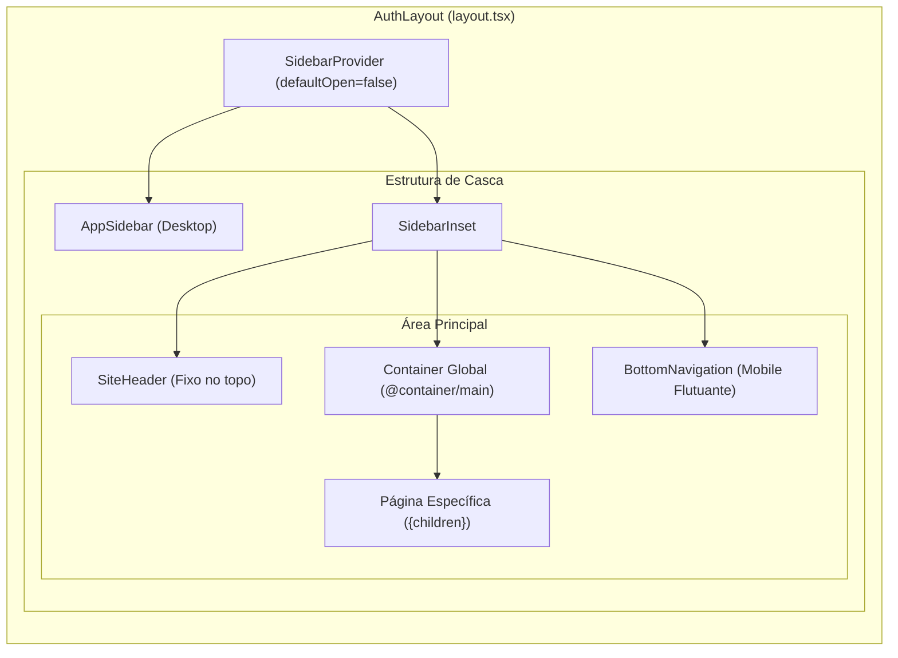

# 03 - Layout e Estrutura de Páginas do Zelo

Este documento estabelece as diretrizes de composição espacial, arquitetura da casca de aplicação (App Shell), contêineres globais, cabeçalhos, barras de navegação e compensações de viewport entre desktop e mobile no **Zelo**.

---

## 1. Casca da Aplicação (App Shell)

As rotas autenticadas (`/produtos`, `/clientes`, `/dashboard`, etc.) são estruturadas a partir de `src/app/(auth)/layout.tsx`.



### 1.1. Dimensões Globais da Casca
- **Largura da Barra Lateral Aberta:** `var(--sidebar-width) = 192px` (`calc(var(--spacing) * 48)`).
- **Largura da Barra Lateral Recolhida:** `calc(var(--spacing) * 12) = 48px` (modo ícone).
- **Altura do Cabeçalho Global:** `var(--header-height) = 48px` (`calc(var(--spacing) * 12)`).

---

## 2. Estrutura de Contêineres e Espaçamentos

### 2.1. Hierarquia de Containers no Layout
No arquivo `src/app/(auth)/layout.tsx`, o miolo do conteúdo possui a seguinte hierarquia obrigatória:

```tsx
<SidebarInset>
  <SiteHeader />
  {/* Contêiner principal com compensação de navegação */}
  <div className="flex flex-1 flex-col pb-24 md:pb-6">
    <div className="flex flex-1 flex-col">
      <div className="@container/main flex flex-1 flex-col gap-2">
        <div className="flex flex-col gap-4 py-4 md:gap-6 md:py-6">
          {children}
        </div>
      </div>
    </div>
  </div>
  <BottomNavigation />
</SidebarInset>
```

### 2.2. A Regra do `pb-24` para Mobile vs. `md:pb-6` no Desktop
> [!IMPORTANT]
> **COMPENSAÇÃO OBRIGATÓRIA DA BOTTOM NAVIGATION**
>
> Em dispositivos móveis, a barra de navegação inferior (`BottomNavigation`) flutua sobre a base da tela em `bottom-[max(env(safe-area-inset-bottom),1rem)]` com altura total aproximada de 64px a 80px.
> Para que os últimos botões, rodapés de tabelas e cartões de lista não fiquem escondidos sob a barra de navegação, o contêiner externo deve manter **`pb-24` no mobile** e **`md:pb-6` no desktop**.

### 2.3. Padding Horizontal das Telas
O padrão confirmado para o contêiner raiz de qualquer página filha é:
```tsx
<div className="w-full px-4">
  {/* Conteúdo da tela */}
</div>
```
*Variação aceita em relatórios analíticos amplos:* `className="w-full px-3 sm:px-6 space-y-4 max-w-7xl mx-auto"`.

---

## 3. Cabeçalho Global (`SiteHeader`)

Localizado em `src/components/layout/site-header.tsx`, o cabeçalho possui comportamento responsivo e contextual:

```tsx
<header className="flex h-(--header-height) shrink-0 items-center gap-2 border-b-0 md:border-b transition-[width,height] ease-linear">
  <div className="flex w-full items-center gap-1 px-4 lg:gap-2 lg:px-6">
    {/* Botão de retorno mobile para subpáginas */}
    {isSubPage && (
      <Link href="/mais" className="md:hidden h-8 w-8 -ml-2 mr-1">
        <ChevronLeft className="h-5 w-5" />
      </Link>
    )}
    
    {/* Gatilho de toggle da sidebar no desktop */}
    <div className="hidden items-center gap-2 md:flex">
      <SidebarTrigger className="-ml-1" />
      <Separator orientation="vertical" className="mx-2 data-[orientation=vertical]:h-4" />
    </div>

    {/* Título dinâmico da página */}
    <h1 className="text-2xl font-bold tracking-tight text-foreground md:text-base md:font-medium">
      {pageTitle}
    </h1>

    {/* Controles à direita */}
    <div className="ml-auto flex items-center gap-2">
      <ModeToggle />
    </div>
  </div>
</header>
```

### 3.1. Regras Confirmadas do Cabeçalho:
1. **Borda inferior condicional:** `border-b-0 md:border-b` (no mobile não há linha separadora no topo para manter a sensação de aplicativo nativo; no desktop há borda separando a barra do conteúdo).
2. **Hierarquia do Título da Página:**
   - No mobile: `text-2xl font-bold` (funciona como o título principal destacado da tela).
   - No desktop: `text-base font-medium` (funciona como identificador contextual sutil ao lado do disparador da barra lateral).
3. **Subpáginas com Botão Voltar:**
   - Rotas secundárias que não possuem botão dedicado na barra inferior móvel (`/historico`, `/usuarios`, `/registros`, `/configuracoes`, `/estoque`) exibem automaticamente um botão de voltar com ícone `ChevronLeft` redirecionando para a central móvel `/mais`.

---

## 4. Barra Lateral Desktop (`AppSidebar`)

Localizada em `src/components/layout/app-sidebar.tsx`, gerencia a navegação em telas maiores (`md:` ou desktop):

- **Modo recolhível:** Utiliza `collapsible="icon"`, permitindo contrair a barra para um trilho compacto de 48px apenas com ícones.
- **Logotipo Adaptativo:**
  - Modo claro: Imagem `/zelo-black.png`.
  - Modo escuro: Imagem `/zelo-white.png`.
- **Item Ativo:**
  - Aplica fundo de destaque `bg-white text-zinc-900 font-semibold shadow-xs dark:bg-[#2A2C30] dark:text-zinc-50`.
  - Ícone ativo com cor plena: `text-black dark:text-white`.
- **Item Inativo:**
  - `text-muted-foreground hover:text-foreground`.
- **Tooltip de Apoio:** No modo contraído em ícone, exibe tooltip do nome da tela ao passar o mouse.

---

## 5. Barra Inferior Móvel (`BottomNavigation`)

Localizada em `src/components/layout/bottom-navigation.tsx`, substitui completamente a barra lateral em telas menores que `768px`:

```tsx
<nav className="fixed inset-x-0 bottom-[max(env(safe-area-inset-bottom),1rem)] z-40 flex justify-center px-4 pointer-events-none md:hidden">
  <div className="pointer-events-auto grid items-center p-1.5 rounded-full bg-[#E9ECF0]/90 dark:bg-[#1C1E22]/90 backdrop-blur-2xl border border-white/80 dark:border-white/10 shadow-[0_12px_40px_rgba(0,0,0,0.12)] w-[calc(100%-1rem)] max-w-107.5">
    {/* Itens de navegação */}
  </div>
</nav>
```

### 5.1. Regras de Composição da Ilha Móvel:
1. **Container Estilo Ilha Flutuante:** Formato de pílula (`rounded-full`), fundo translúcido `backdrop-blur-2xl` e sombra difusa elevada (`shadow-[0_12px_40px_rgba(0,0,0,0.12)]`).
2. **Botão Central "Vender" em Destaque:**
   - O item central `/nova-venda` recebe tratamento visual diferenciado: `w-11 h-11 rounded-full bg-primary text-primary-foreground shadow-md shadow-primary/25 active:scale-95`.
3. **Item Comum Ativo:**
   - Recebe pílula de fundo branca / carvão: `w-14 h-11 rounded-full bg-white dark:bg-[#2A2C30] shadow-[0_2px_10px_rgba(0,0,0,0.08)]`.
4. **Transformação do 5º Item em "Mais":**
   - O quinto item da navegação principal, que no desktop é `/historico`, no mobile é convertido em `/mais` com BoxIcon `menu`, servindo como menu para acessar as demais páginas secundárias e sair do sistema.
