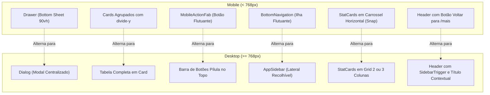

# 15 - Responsividade e Comportamento Mobile

Este documento estabelece as regras de responsividade, breakpoints, transformações estruturais de layout e as convenções específicas de toque e PWA no **Zelo**.

---

## 1. Breakpoints e Detecção de Dispositivo

O Zelo adota como divisor principal de experiência o breakpoint de **768 pixels**, correspondente à chave `md:` do Tailwind CSS v4.

### 1.1. Tabela de Breakpoints Reais
| Chave | Largura Mínima | Papel no Zelo |
|---|---|---|
| *(Base)* | `< 640px` | Celulares e smartphones em orientação retrato (Mobile First) |
| `sm:` | `>= 640px` | Celulares grandes e tablets pequenos |
| `md:` | `>= 768px` | **Divisor Oficial:** Transição de Mobile para Desktop |
| `lg:` | `>= 1024px` | Laptops e monitores convencionais |
| `xl:` | `>= 1280px` | Monitores amplos (split screen de login/cadastro) |
| `@container` | Variável | Container Queries locais para cards de KPI e headers |

### 1.2. O Hook `useIsMobile()`
Localizado em `src/hooks/use-mobile.ts`:
```tsx
const MOBILE_BREAKPOINT = 768;

export function useIsMobile() {
  // Retorna true para larguras estritamente menores que 768px
}
```
> [!IMPORTANT]
> **QUANDO USAR `useIsMobile()` VS. CLASSES CSS `md:`**
>
> - **Use `useIsMobile()`** quando o componente precisa alternar a árvore de renderização do DOM (ex.: renderizar `<Drawer />` no mobile versus `<Dialog />` no desktop; alternar a quantidade de itens por página na TanStack Table com `table.setPageSize(isMobile ? 5 : 8)`).
> - **Use classes CSS (`hidden md:flex`, `flex md:hidden`)** quando os dois layouts coexistem no DOM sem impacto significativo de performance (ex.: botão de ação no header versus FAB).

---

## 2. Componentes com Mudança Estrutural (Polimorfismo Responsivo)

O Zelo não se limita a "encolher" elementos no mobile: vários componentes centrais mudam completamente sua estrutura e mecânica de interação entre desktop e mobile:



### 2.1. Tabela Desktop vs. Cards Mobile
- **Desktop:** `<Table className="table-fixed w-full">` com ordenação por cabeçalho, colunas formatadas e botões compactos.
- **Mobile:** Contêiner único com cantos arredondados `rounded-2xl` e divisores `divide-y divide-border/50`, priorizando thumbnail grande (56px), nome em destaque, tom de estoque dinâmico e menu de 3 pontos.

### 2.2. Dialog Desktop vs. Drawer Mobile
- **Desktop:** Modal centralizado com largura de 512px a 768px e backdrop blur.
- **Mobile:** Painel deslizante de baixo para cima ocupando 90% da altura da tela (`h-[90vh]`), miolo com `ScrollArea` e botões de ação fixos na base em largura total.

### 2.3. Barra Superior Desktop vs. MobileActionFab
- **Desktop:** Ações da página exibidas como botões em formato pílula (`rounded-full`) alinhados à direita da barra superior.
- **Mobile:** Botão flutuante FAB no canto inferior direito (`MobileActionFab`), despoluindo o cabeçalho móvel.

### 2.4. StatCards em Grid vs. Carrossel com Snap
- **Desktop:** Grid de 2 ou 3 colunas (`sm:grid-cols-2 lg:grid-cols-3`).
- **Mobile:** Carrossel horizontal deslizável com efeito magnético de parada (`flex overflow-x-auto pb-4 -mx-4 px-4 snap-x snap-mandatory [&>div]:min-w-[85vw] [&>div]:snap-center`).

---

## 3. Diretrizes de Usabilidade Tátil e PWA

O Zelo incorpora configurações avançadas em `src/app/globals.css` para aproximar a interface de um aplicativo móvel nativo:

### 3.1. Prevenção de Seleção Acidental de Texto
Em telas touch (`@media (pointer: coarse)` ou modo PWA instalado), o sistema bloqueia seleções involuntárias ao rolar a tela ou tocar rapidamente:
```css
body {
  -webkit-user-select: none;
  user-select: none;
  -webkit-touch-callout: none;
  -webkit-tap-highlight-color: transparent;
}
```

### 3.2. Preservação Estrita de Edição e Seleção em Campos
Para nunca atrapalhar a digitação ou comandos de copiar/colar:
```css
input,
textarea,
[contenteditable="true"],
[data-slot="input"],
[data-slot="textarea"],
.selectable,
pre,
code {
  -webkit-user-select: text !important;
  user-select: text !important;
  -webkit-touch-callout: default !important;
}
```

### 3.3. Proteção contra Toque Longo em Imagens
Previne o balão nativo do navegador mobile de download ou compartilhamento ao segurar o dedo sobre thumbnails:
```css
img {
  -webkit-touch-callout: none;
  -webkit-user-drag: none;
  user-select: none;
}
```

### 3.4. Áreas Mínimas de Toque (Touch Targets)
- Todos os botões clicáveis no mobile mantêm altura mínima de **40px a 44px** (`h-10` ou `h-11`).
- Botões de ícone possuem área estendida de clique para evitar toques frustrados.
- Controles de scrollbar nativa são ocultados globalmente (`display: none; scrollbar-width: none;`), garantindo que barras de rolagem não colidam com o polegar.

### 3.5. Tratamento de Safe Area (Bordas de Entalhe e Barra Home)
Controles fixos na base da viewport integram a variável CSS nativa:
```css
bottom: max(env(safe-area-inset-bottom), 1rem);
```
Isso impede que botões fiquem sobrepostos à barra gestual do iOS ou à barra de navegação virtual do Android.
