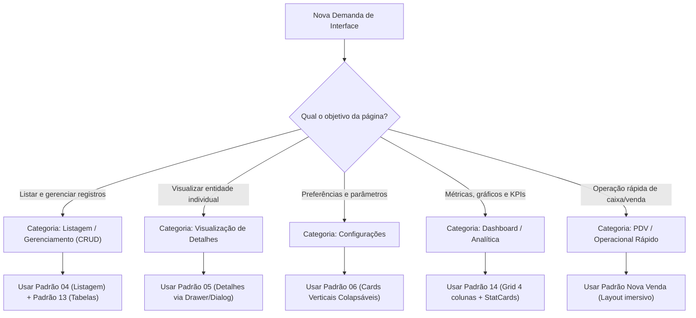

# 18. Guia Prático e Regras para Criação de Novas Páginas

Este documento serve como **manual definitivo e checklist obrigatório** para qualquer desenvolvedor ou agente de inteligência artificial encarregado de implementar uma nova página ou funcionalidade no ecossistema Zelo.

Nenhuma página deve ser entregue sem cumprir integralmente as etapas e validações descritas a seguir.

---

## 1. Fluxo de Decisão e Classificação da Página

Antes de escrever qualquer linha de código, determine a qual das categorias estruturais a nova funcionalidade pertence:



---

## 2. Roteamento, Layout e Segurança (Passo a Passo)

### 2.1. Localização no Sistema de Pastas
Toda página restrita ao lojista deve residir sob a pasta `src/app/(auth)/`:
```text
src/app/(auth)/[nome-do-modulo]/page.tsx
```
Ao ser colocada dentro do grupo `(auth)`, a página herda automaticamente:
1. Verificação de sessão JWT ativa via cookies.
2. Redirecionamento para `/onboarding` se o cadastro for recente e incompleto.
3. Injeção do [SiteHeader](file:///c:/projetos/zelo/src/components/layout/site-header.tsx) e do [BottomNavigation](file:///c:/projetos/zelo/src/components/layout/bottom-navigation.tsx).
4. Contexto global de permissões RBAC (`PermissionsProvider`).

### 2.2. Proteção de Permissões (RBAC)
No frontend, proteja a página ou seus blocos sensíveis através do hook `usePermissions` ou do componente `<Can />`:

```tsx
import { Can } from "@/components/can";
import { usePermissions } from "@/components/auth/permissions-provider";

export default function NovoModuloPage() {
  const { can } = usePermissions();

  if (!can("novo-modulo", "Visualizar")) {
    return <AcessoNegado />;
  }

  return (
    <div className="space-y-6 pb-24 md:pb-6">
      {/* Conteúdo */}
      <Can module="novo-modulo" action="Adicionar">
        <Button onClick={handleCreate}>Novo Item</Button>
      </Can>
    </div>
  );
}
```

---

## 3. Template Base para Páginas de Listagem (CRUD)

Copie e adapte a estrutura abaixo para criar qualquer nova tela de listagem de registros:

```tsx
"use client";

import { useState, useTransition } from "react";
import { BoxIcon } from "@/components/ui/box-icon";
import { Button } from "@/components/ui/button";
import { Input } from "@/components/ui/input";
import { Card } from "@/components/ui/card";
import { TablePagination } from "@/components/ui/table-pagination";
import { MobileActionFab } from "@/components/ui/mobile-action-fab";
import { Popover, PopoverContent, PopoverTrigger } from "@/components/ui/popover";
import { Can } from "@/components/can";
import { useIsMobile } from "@/hooks/use-mobile";

export default function ExemploListPage() {
  const isMobile = useIsMobile();
  const [search, setSearch] = useState("");
  const [page, setPage] = useState(1);
  const [isFormOpen, setIsFormOpen] = useState(false);
  const [isPending, startTransition] = useTransition();

  return (
    <div className="space-y-6 pb-24 md:pb-6">
      {/* 1. CABEÇALHO DA PÁGINA */}
      <div className="flex flex-col gap-4 sm:flex-row sm:items-center sm:justify-between">
        <div>
          <h1 className="text-2xl font-bold tracking-tight text-foreground">
            Nome do Módulo
          </h1>
          <p className="text-sm text-muted-foreground">
            Gerencie e acompanhe todos os registros da sua loja.
          </p>
        </div>

        {/* Ação Primária Desktop (Oculta no mobile) */}
        <div className="hidden md:flex md:items-center md:gap-3">
          <Can module="novo-modulo" action="Adicionar">
            <Button
              onClick={() => setIsFormOpen(true)}
              className="rounded-full font-medium h-9 px-4 gap-2 shadow-xs"
            >
              <BoxIcon name="plus" className="text-lg" />
              Novo Registro
            </Button>
          </Can>
        </div>
      </div>

      {/* 2. ÁREA DE PESQUISA E FILTROS */}
      <div className="flex flex-col gap-3 sm:flex-row sm:items-center">
        {/* Campo de Busca com ícone embutido */}
        <div className="relative flex-1">
          <BoxIcon
            name="search"
            className="absolute left-3.5 top-1/2 -translate-y-1/2 text-muted-foreground text-lg pointer-events-none"
          />
          <Input
            value={search}
            onChange={(e) => setSearch(e.target.value)}
            placeholder="Buscar por nome, código ou referência..."
            className="h-11 rounded-xl pl-10 pr-4 text-base md:text-sm bg-background border-border/80 shadow-2xs"
          />
        </div>

        {/* Botão de Filtros com Popover */}
        <div className="flex items-center gap-2">
          <Popover>
            <PopoverTrigger asChild>
              <Button
                variant="outline"
                className="h-11 rounded-xl px-4 gap-2 border-border/80 text-muted-foreground hover:text-foreground"
              >
                <BoxIcon name="slider-alt" className="text-lg" />
                <span className="hidden sm:inline">Filtros</span>
              </Button>
            </PopoverTrigger>
            <PopoverContent align="end" className="w-80 p-4 rounded-xl shadow-xl">
              <h4 className="font-semibold text-sm mb-3">Filtrar Registros</h4>
              {/* Opções de filtro */}
            </PopoverContent>
          </Popover>
        </div>
      </div>

      {/* 3. PAGINAÇÃO MOBILE (Acima da listagem) */}
      <div className="md:hidden">
        <TablePagination
          pageIndex={page}
          pageSize={10}
          totalFiltered={50}
          pageCount={5}
          canPreviousPage={page > 1}
          canNextPage={page < 5}
          onPreviousPage={() => setPage(page - 1)}
          onNextPage={() => setPage(page + 1)}
        />
      </div>

      {/* 4. VISUALIZAÇÃO DE DADOS (Híbrida: Tabela no Desktop / Cards no Mobile) */}
      {isMobile ? (
        // Mobile: Card com divisão interna suave
        <Card className="rounded-2xl border border-border/70 bg-card p-0 overflow-hidden divide-y divide-border/50 shadow-xs mb-6">
          {/* Mapeamento de itens mobile */}
        </Card>
      ) : (
        // Desktop: Tabela estruturada
        <Card className="rounded-2xl border border-border/70 bg-card p-0 overflow-hidden shadow-xs">
          <div className="overflow-x-auto">
            <table className="w-full text-left border-collapse text-sm">
              <thead className="bg-muted/40 text-muted-foreground font-medium border-b border-border/60">
                <tr>
                  <th className="py-3 px-4">Nome</th>
                  <th className="py-3 px-4">Status</th>
                  <th className="py-3 px-4 text-right">Ações</th>
                </tr>
              </thead>
              <tbody className="divide-y divide-border/40">
                {/* Linhas da tabela */}
              </tbody>
            </table>
          </div>
        </Card>
      )}

      {/* 5. PAGINAÇÃO DESKTOP (Abaixo da tabela) */}
      <div className="hidden md:block mt-4">
        <TablePagination
          pageIndex={page}
          pageSize={10}
          totalFiltered={50}
          pageCount={5}
          canPreviousPage={page > 1}
          canNextPage={page < 5}
          onPreviousPage={() => setPage(page - 1)}
          onNextPage={() => setPage(page + 1)}
        />
      </div>

      {/* 5. AÇÃO PRIMÁRIA MOBILE (FAB Flutuante) */}
      <Can module="novo-modulo" action="Adicionar">
        <MobileActionFab
          icon="plus"
          label="Adicionar"
          onClick={() => setIsFormOpen(true)}
        />
      </Can>

      {/* 6. MODAL/DRAWER HÍBRIDO DE CADASTRO/EDIÇÃO */}
      {/* Renderizar componente Form com isMobile */}
    </div>
  );
}
```

---

## 4. Diretrizes de Construção de Formulários

Ao criar um formulário para a nova página:
1. **Validação Estrita com Zod:** Crie um schema no arquivo `src/lib/validations/[modulo].ts`. Campos opcionais devem aceitar `.nullable().optional()`.
2. **Prevenção de Perda de Dados:** Salve rascunhos no `localStorage` via hook unificado com chave `draft_[modulo]_[id]`.
3. **Labels e Campos Obrigatórios:**
   - Use `<Label htmlFor="..." required>Título</Label>` para campos mandatários.
   - Aplique a constante `requiredInputClass` nos inputs correspondentes.
4. **Fechamento Seguro:**
   - O `Dialog` ou `Drawer` hospedeiro deve receber `disablePointerDismissal={true}` e `preventEscapeClose={true}`.
   - Se o formulário estiver sujo (`form.formState.isDirty`), intercepte o fechamento com confirmação ou salve o rascunho silenciosamente.
5. **Máscaras Brasileiras:**
   - Use as funções de [src/lib/masks.ts](file:///c:/projetos/zelo/src/lib/masks.ts) para telefone (`maskPhone`), CPF/CNPJ (`maskCpfCnpj`), CEP (`maskCep`) e valores monetários.
6. **Botão de Submissão:**
   - Utilize obrigatoriamente `<LoadingButton loading={isSubmitting} loadingText="Salvando...">Salvar</LoadingButton>`.

---

## 5. Diretrizes de Comunicação e Feedback com o Usuário

1. **Sucesso:**
   ```tsx
   toast.success("Registro criado com sucesso!", {
     description: "Os dados já estão disponíveis no sistema.",
   });
   ```
2. **Erro Amigável (Nunca exiba stack trace ou mensagem crua da API):**
   ```tsx
   toast.error("Não foi possível salvar o registro.", {
     description: error?.message || "Verifique sua conexão e tente novamente.",
   });
   ```
3. **Sincronização em Tempo Real:**
   - Após mutações com sucesso, acione a atualização local e despache o evento de broadcast `useDataSync` para atualizar outras abas abertas pelo mesmo usuário.

---

## 6. Pre-flight Checklist (Verificação Pré-Entrega)

Antes de considerar qualquer nova página ou alteração concluída, valide rigorosamente cada um dos itens abaixo:

| Item | Critério de Aceitação | Verificado? |
| :---: | :--- | :---: |
| **1** | A página inclui o espaçamento inferior `pb-24 md:pb-6` para não cobrir o `BottomNavigation`? | [ ] |
| **2** | O botão de ação primária fica no cabeçalho em desktop (`rounded-full h-9 px-4`) e vira `<MobileActionFab />` no mobile? | [ ] |
| **3** | A ação primária é protegida pelo componente `<Can module="..." action="...">`? | [ ] |
| **4** | O campo de pesquisa tem altura `h-11 rounded-xl` com ícone Boxicons `"search"` posicionado à esquerda? | [ ] |
| **5** | Os formulários abrem como `Drawer` no mobile (`h-[90vh]`) e como `Dialog` no desktop (`sm:max-w-xl` ou `sm:max-w-2xl`)? | [ ] |
| **6** | O Drawer e o Dialog bloqueiam clique fora e ESC via `disablePointerDismissal` e `preventEscapeClose`? | [ ] |
| **7** | Os campos obrigatórios utilizam `<Label required>` e a classe `requiredInputClass`? | [ ] |
| **8** | Todos os inputs e textareas possuem o tamanho `text-base md:text-sm` para prevenir zoom no Safari do iOS? | [ ] |
| **9** | Todos os ícones são renderizados via `<BoxIcon name="..." />` (com exceção fundamentada e documentada)? | [ ] |
| **10** | A página renderiza um estado vazio amigável (`EmptyState`) com ilustração/ícone e botão de criação quando não houver dados? | [ ] |
| **11** | Não há transbordamento ou rolagem horizontal em nenhuma tela (`overflow-x-hidden`)? | [ ] |
| **12** | O feedback de ações bem-sucedidas ou falhas é apresentado via `toast.success` e `toast.error` da biblioteca `sonner`? | [ ] |
| **13** | A página respeita o Dark Mode, utilizando classes semânticas (`bg-background`, `text-foreground`, `border-border/70`) sem cores hexadecimais puras fixas no código? | [ ] |
